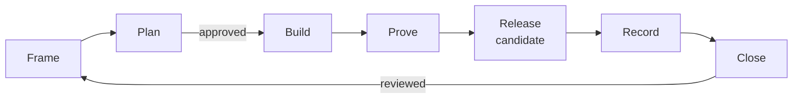

# Feature pipeline

A feature ships as a slice: one thing a person can do, built through its real
path, proven, released as a candidate they can install, shown working, and
reviewed before the next slice starts. This skill is the order of work and the
gate that ends each stage.

How code is written is `code-discipline`. How plans and pages read is
`spec-docs` and `writing-plans`. The project's own docs skill adds its names,
layout and commands, and wins where it differs.

- Rust projects: [references/rust.md](references/rust.md), including what
  slice 0 sets up.
- Hardening between slices: [references/audit.md](references/audit.md).

## Every stage

- **One slice at a time.** The next starts only once the user has reviewed
  this one.
- **Ask with the question tool**, recommended option first and marked
  "(Recommended)". Ask only what the code, docs, history and memory cannot
  answer; search them first.
- **Stop and ask before** code for an unapproved plan, a production
  dependency, a release tag, approving a deploy, weakening a gate, and
  anything others see that cannot be taken back.
- **Commits.** One Conventional Commit per change, each building and passing
  on its own. Behavior changes and mechanical refactors go in separate
  commits. A doc whose truth changes, changes in the same commit.
- **Evidence.** A stage is done when its check ran and passed, not when the
  code looks right. A failure is reported with its command and output.
- **Leave nothing behind.** Remove what you started: scratch folders, test
  sessions, daemons, preview servers, browser sessions. Leave what the user
  runs.

## 1. Frame

Name the feature as what a person can do once it ships, with one example. It
runs through the real path: the real harness or caller, the real boundary
(socket, HTTP, CLI) and the real model or service. Build only what this
feature needs, and no layers for later slices.

- Add it to the slice index as Planned, after the slices it depends on.
- Give a person a way to try it: the real harness, a CLI command, or a small
  interactive page (a playground tab) while there is no harness yet.
- When the project replaces an older one, list the old behaviors this slice
  carries over in a parity table, with the old repository's commit watermark.

**Done when** the slice has a title, a "You can" sentence with an example, and
its place in the index.

## 2. Plan

Read first: the affected code, its callers and tests, the project's docs, and
the current official docs of every library, API and tool it touches
(`read-the-damn-docs`, Context7). Run the baseline gates and note what
already fails.

Write the slice page as `spec-docs` lays it out: status, You can, a Mermaid
diagram of the path, What it builds (for each part: overview, files, usage as
calls with real arguments, verification), and End to end, the checks in the
real environment. A Planned page shows no Structure.

- Name each new dependency, why it is needed, and what else was considered.
- Name the proofs: tests, property tests or model-checking harnesses, and the
  real-path check.
- Collect open questions in one place, then ask them.

**Gate:** the user approves the plan. No code before that.

## 3. Build

Set the status to In progress and follow `code-discipline` with its language
reference.

- **Model first:** the types and state machines compile before the functions.
- **Vertical:** the smallest complete behavior through the real boundary
  first, then widen it.
- **Bugs:** a fix starts with a test that fails on the old code.
- **Bounded:** every queue, loop, connection, folder walk, retry and wait has
  a limit and an end. Every request settles on success, error, timeout and
  the peer closing.
- **Structure:** write the slice page's Structure from the code as it lands,
  and change it in the commit that changes the code.
- **Layout:** a module that grows past one concept becomes a directory named
  after it, one file per concept, with a `README.md`.

**Done when** the feature works through its real path on this machine.

## 4. Prove

Run every gate the project has; a warning fails it.

- Format, lint with warnings denied, type check.
- Unit, integration and doc tests, and the tests of adapters or clients in
  their own language.
- Build, package, and the smoke test on the packaged artifact.
- Mutation testing over the files the slice changed. Every viable mutant is
  caught; an equivalent one is excluded by name, with a comment saying why.
- The proofs the plan named.
- Benchmarks when a hot path changed: compare with the base commit locally,
  10 runs each, since timings are noisy. CI runs each benchmark once, only to
  keep it building.
- The playground or demo in a real browser.
- The feature through its real harness or caller, with real models.

A test that fails sometimes is a bug. Run it in a loop until it fails (30 to
60 runs), run the same loop on the old tree to see whether the change caused
it, then fix the cause. Never retry until green.

Check exit statuses directly: piping into `tail` or `rg` hides a failure, so
use `set -o pipefail` or read the tool's own status.

**Done when** all of it passed on the final tree.

## 5. Release a candidate

The user can install what the slice built, beside any stable release.

1. Ask whether to cut it now.
2. Bump the version to the next `rc.N`, update the lockfile, commit
   `chore(release): X`, push, and wait for CI to pass on that commit.
3. Tag `vX`, push the tag, and watch the release workflow to the end.
4. The step that reaches users, such as a Homebrew tap or a registry, waits in
   a protected environment for the user's approval.
5. Install it the way the user would and check its version.

The candidate installs under its own name, with its own socket, configuration
and state folders, so it never disturbs the stable install.

## 6. Record

Show the released candidate working end to end: the installed rc, its real
models and the real harness, never a stand-in.

- Drive the terminal with `termctrl` (the `terminal-control` skill). Record
  the harness and the system's own log as two panes, marked at the same
  moments, with captions naming each step.
- Work in a scratch repository in the temp folder whose configuration loads
  only the rc, so the user's other plugins and memory stay out.
- Keep private things off screen (session titles, keys, other projects), and
  look at frames of the finished video before committing it.
- Record again until a take shows the feature; a take where the feature is
  never triggered proves nothing.
- Embed it under `## Recording`, right after the slice page's diagram: a few
  sentences on what it shows, then the video (H.264, 1600 pixels wide, under
  1 MB).

The project's docs skill holds the exact commands, such as a `recording.md`.

## 7. Close

- Set the status to Implemented, with the rc's version. The page reads:
  status, You can, diagram, Recording, What it builds, End to end.
- Run the docs format and build (no dead links), open the changed pages in the
  built site, and check that every diagram rendered: count rendered diagrams
  against the Mermaid fences.
- Push, and watch CI and the docs deploy to the end.
- Clean up.
- Report what a person can do now, the evidence (gates, rc, recording), what
  is left open, and the proposed next step. Then stop for review.

## Between slices: harden

When the user asks, and before a cutover, audit the project as
[references/audit.md](references/audit.md) describes. Findings become issues,
each fix comes with a regression test, the audit page stays current, and the
fixes ship in the next rc.

## Traps

- A `gh` body with backticks inside a shell string runs them as commands.
  Write the body to a file and pass `--body-file`.
- Escaped backticks from a template literal reach the file as `\`` and break
  Markdown fences. Check the rendered page, not only the source.
- Prettier keeps prose line breaks as written; rewrap an edited paragraph by
  hand.
- An HTML block such as `<video>` stays on one line, or Markdown reads it as
  text.
- For a lint false positive, first restructure the code so it says what it
  means; a scoped `#[expect(..., reason = "...")]` comes last.
- A timestamp formatted without a fixed precision changes width from one
  value to the next. Fix the precision.
- When a harness guard blocks a command, such as printing files from the
  shell or redirecting into the repository, use the read, edit and write
  tools.
