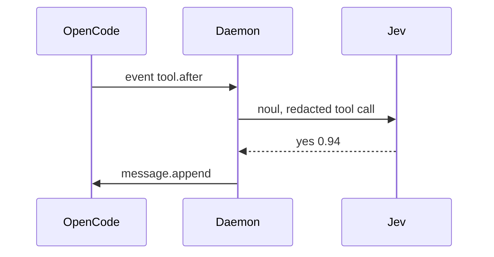

# Spec docs

A spec describes the design as it is, as the first and only draft. A reader
with no chat history understands it, and cannot tell what an earlier draft
said. The project's own docs skill, when there is one, adds its names,
layout and checks; where the two differ, the project's wins.

## Voice

- Present tense, as if the thing exists. No revision history: never
  "previously", "now", "instead of", "renamed from", "no longer", or a
  correction of an earlier draft. Keep a contrast only between two real
  alternatives being decided, such as "Postgres, not SQLite: there are
  concurrent writers".
- Plain language, top down: what it does for a person first, then how, each
  with a concrete example.
- Lead with the decision and cut the wind-up. One example, not three.
- State each decision once, in its canonical page, and link to it elsewhere.
- Something designed but not built is marked by its status, not by hedges in
  the prose. Open questions go in one place, not through the text.

## Code examples

Show how a thing is used, not how it is defined: a call with real arguments
and its result, a config fragment, a command and what it prints. The reader
could paste it and run it. Show a definition only when its shape is the
design, such as a wire message or a data model, and then its smallest form.

Give code room to breathe. One blank line separates each step: setup, the
call, using the result.

```ts
const quick = judge({ tier: "system-one", confidence: 0.7 });

const commit = await ask(
  noul("Does this commit message break Conventional Commits?"),
  { judge: quick, evidence },
);

if (commit.ok && commit.outcome === "yes") {
  nudge(commit);
}
```

- A braced block (`if`, `for`, `while`, `match`, `try`) gets a blank line
  above and below, except at the start or end of its scope. Prefer braces to
  a braceless `if` that spans lines.
- A guard such as `if (!e.first) return` gets a blank line after it; a run of
  guards, with the line they test, stays together.
- A one-line `if` that acts on the line before it stays with that line.
- Never two blank lines in a row, and none at the start or end of a scope. A
  snippet of two or three lines is one step and stays dense.
- Name a value to keep a line short and readable (`const cold = …`), rather
  than one long condition.
- `…` stands for what does not matter, such as `{ "text": "…" }`.

## Diagrams

Draw with Mermaid, and draw often: a diagram is usually the fastest way into a
design. Each page that explains a flow, a structure or a sequence opens with
one, and the prose then walks through it.

- Pick the kind that fits: `sequenceDiagram` for who calls whom in order,
  `flowchart LR` for a path or pipeline, `flowchart TD` for layers,
  `stateDiagram-v2` for states, `erDiagram` for data.
- Several small views beat one crowded diagram: how one request flows, how
  the code is layered, where configuration lives.
- Name nodes as the reader would, with real names such as `Daemon` or
  `audit.jsonl`, and put detail on a second line with `<br/>`. Label each
  edge with what crosses it, such as `event tool.after` or `yes 0.94`.
- Eight to twelve nodes at most; split anything larger.
- Quote any label with punctuation, `Node["like this: (and this)"]`, so it
  parses.
- Every diagram must parse and render: look at it in the built page, not just
  the source.



## Line length

Every line fits in the project's width, 85 columns unless it says otherwise,
prose and code. Formatters such as Prettier keep prose line breaks as
written, so wrap prose by hand. In code, split a long call over lines, or
break a shell command with `\`. A comment that would run past goes on its
own line above the code, as a sentence. Only what cannot break may run past:
a link, a long string in JSON, a Mermaid label, a line of real output.

## Slice pages

A spec built in slices (or phases, or milestones) has one page per slice and
an index listing each with its status. Each page has, in order:

1. Its title, then its status: Implemented, In progress, Planned or Held,
   with what is left or what it waits on.
2. What a person can do once it ships, with an example.
3. A Mermaid diagram of the path through the feature.
4. What it builds: a heading per part, each with a short overview, its files,
   a code example, its structure when the status calls for it, and how it is
   verified.
5. End to end: the checks in the real environment.

How much a part shows depends on the slice's status:

| Status                   | Each part shows                                     |
| ------------------------ | --------------------------------------------------- |
| In progress, Implemented | Overview, files, usage, **Structure**, verification |
| Planned, Held            | Overview, files, usage, verification                |

A planned slice shows how its pieces will be used, so it can be reviewed
before any code exists. When a slice starts, write its Structure from the
code; when the code changes, change it in the same commit.

### Structure

The part's types as code, read from the code, in small blocks: one block per
logical piece, such as a type and its methods, or a type with the enums it
returns. Before each block, a short explainer in prose says what the piece is
for and what the signatures do not: what a method refuses, a default, a
bound. The code itself carries no comments.

- Structs and enums with their fields or variants; `pub` shows what is
  public.
- Each method and function as its signature, ending in `;`.
- A hand-written trait impl as `impl Trait for Type {}`.
- Leave out derives and private helpers. Error enums may list fields by
  name only, such as `UnknownJudge { rule, step, judge }`.
- Break long signatures the way the formatter would, to fit 85 columns.

````markdown
A fallback is a tier's models in order: `preferred` first, then the tier's
order, each once, leaving out a model whose key is missing.

```rust
pub struct Fallback {
    models: Vec<Model>,
}

impl Fallback {
    pub fn build(
        models: &Models,
        tier: Tier,
        preferred: Option<&str>,
        key: impl Fn(&str) -> Option<String>,
    ) -> Result<Self, ConfigError>;
}
```
````

### Proofs

A part verified by a proof, such as a Kani harness or a property test, shows
the proof as pseudocode under its verification: what ranges over all values,
with its bounds, and what is asserted. Say in prose what it proves and for
how much, such as "every two or three outcomes".

```text
for all p   = 2 or 3 probabilities, each 0 to 1000 thousandths
for all bar = for each outcome, a bar from 0 to 1000, or none

picked = pick(p, bar)

for each outcome i:
    only_likeliest = every other p[j] < p[i]
    meets          = bar[i] is some b and p[i] >= b

    assert (picked == i) == (only_likeliest and meets)
```

## Before committing

1. Scrub for history words: actually, corrected, earlier, previously,
   originally, no longer, used to, instead of, rather than, supersedes.
2. Run the project's formatter and docs build, and fix dead links.
3. Look at the changed pages as a reader will, diagrams included.
4. Commit with the project's message convention, such as
   `docs(plan): …` in Conventional Commits.
