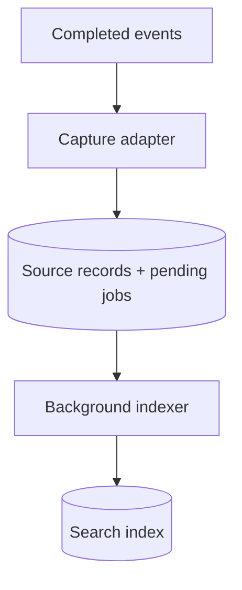
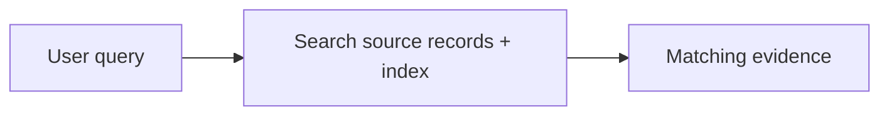

# Visual Plans

Make the architecture understandable at a glance. The default deliverable is
a Mermaid diagram and focused Markdown tables directly in the conversation.
No hosted plan, MCP connector, account, local preview server, or external
planning tool is required. The user should not have to leave chat to review it.

## When to use

- Explain a system's architecture, ownership boundaries, or data flow.
- Review a design before implementation.
- Compare approaches or show a proposed change to an existing system.
- Turn a prose-heavy plan into a visual, scannable explanation.

Skip the planning ceremony for trivial, unambiguous edits. Match the depth to
the request: an architecture review needs relationships and decisions, not a
full implementation roadmap.

## Read before drawing

- Read the relevant local files, docs, and interfaces. Follow docs-first
  guidance for external APIs and libraries.
- Show the real components and boundaries; don't invent services or endpoints.
- Distinguish the current implementation from proposed components. Label a
  proposed design clearly when it is not implemented.
- Preserve the user's level of abstraction. A motivating example or provider
  is not automatically the whole architecture.
- Resolve facts from the code yourself. Ask only about choices that materially
  change the design and cannot be inferred from the request.

## Default response shape

Start with a short heading and, if necessary, one sentence describing the goal.
Then present:

1. **Architecture diagram:** a fenced `mermaid` block showing one clear workflow.
   Split distinct workflows into separately titled diagrams when needed.
2. **Responsibilities table:** who does what. Include a boundary column only
   when it prevents a real misunderstanding.
3. **Decisions table:** the few load-bearing rules, such as scope, scheduling,
   failure handling, privacy, and source of truth.

Use only the sections that earn their place. A table alone is enough for a
simple comparison. Prefer several small workflow diagrams to one crowded graph.
Avoid paragraphs repeating the diagram or table.

## Diagram quality

- Use Mermaid `flowchart TB` for layers or `flowchart LR` for a genuinely
  sequential flow. Use `sequenceDiagram` when ordering is the main question.
- Give each diagram one reading direction, one clear starting point, and a
  visible outcome. A reader should be able to follow the workflow without
  tracing arrows back and forth.
- Aim for 3-7 nodes per workflow. Group related components with `subgraph`
  when useful, but do not use grouping to justify a crowded diagram.
- Minimize crossing arrows, backward arrows, bidirectional links, and fan-in
  or fan-out. Show only edges needed to explain this workflow.
- Separate capture, background processing, automatic context injection, and
  on-demand retrieval when combining them would create an arrow maze.
- Repeat a shared component in separate diagrams when it improves readability;
  use the same name and explain that it is the same component, not a new service.
- Put shared storage dependencies in a short table or note when drawing every
  read/write edge would obscure the workflow. Never imply that an omitted
  dependency does not exist.
- Give nodes plain-language names and one short responsibility. Use quoted
  labels and ` ` for short multiline flowchart labels.
- Use cylinders for persistent stores: `DB[("Local database")]`.
- Label arrows when their contents or purpose would otherwise be ambiguous.
- Keep feedback loops and retry paths in a separate diagram or short rule
  unless they are the main subject of the workflow.
- Check the final diagram for an obvious start-to-finish path. If it still
  requires explaining the arrows in prose, simplify or split it.
- Keep IDs simple, labels short, and syntax portable. Avoid decorative colors,
  elaborate styling, icons, and HTML beyond line breaks.
- Do not imply a security boundary, ordering guarantee, or implementation
  status that the design does not actually provide.

## Table quality

- Use short, specific cells. Prefer 3 columns or fewer.
- Assign each responsibility to one owner.
- State decisions declaratively, with a brief rationale only when needed.
- Distinguish confirmed outcomes from proposals and assumptions.
- Keep unresolved choices in one **Open questions** section; omit it when
  there are none. Give a recommended default for each genuine choice.

## Planning discipline

- Plans describe the design as a standalone proposal, not the conversation
  history. Avoid revision language and backward-pointing corrections.
- Reuse existing components first; make the new delta explicit.
- Decide hard-to-reverse boundaries: persistent IDs, provenance, ownership,
  storage, scope, and deletion semantics.
- For implementation plans, add a short ordered checklist naming real files
  or areas, the smallest useful first cut, and verification. Keep deferred work
  explicit. Don't add a roadmap to an architecture-only explanation.
- Planning is read-only. A review request is not authorization to implement.
  Ask for approval with the question tool only when implementation is the
  intended next step; don't add a redundant approval question to an explanation.
- Don't spawn reviewers or exploration agents unless the user or applicable
  project instructions ask for delegation.

## Small example

**Proposed background indexing architecture**

**Capture and indexing**

**Search**

Source records, pending jobs, and the search index live in one local database.

| Component | Responsibility |
|---|---|
| Capture adapter | Record events with source IDs and scope |
| Background worker | Process queued jobs without blocking requests |
| Database | Preserve originals and rebuildable indexes |

| Concern | Decision |
|---|---|
| Scope | Inherited from the request's project |
| Failure | Keep the source record and retry the queued job |
| Retrieval | Return evidence linked to its original record |

The example illustrates presentation, not a prescribed backend or technology.

## Other formats

- If the user requests a repo-owned plan, write the same concise diagram and
  tables to a Markdown file using the project's plan location.
- If Mermaid cannot render in the user's client, use a compact text diagram
  and the same tables.
- Use an external visual editor, interactive prototype, or hosted plan only
  when the user explicitly requests it. Missing tools for that optional format
  must not block the default inline architecture review.
- For UI-specific work, show the relevant screens or states when requested;
  don't add a canvas, prototype, or browser session to a backend explanation.
